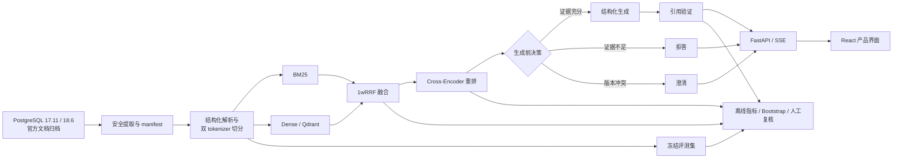

# DocGuard-RAG

面向版本化技术文档的可追溯、可拒答 RAG 问答与评测平台。

[](https://github.com/Aoongu/DocGuard-RAG-Public/actions/workflows/ci.yml)


> Traceable and abstention-aware QA for versioned technical documentation.

普通 RAG 系统往往只展示一段生成文本。DocGuard-RAG 进一步回答四个工程问题：答案来自哪个文档版本、检索与重排经过了哪些步骤、引用是否真的来自已提供证据、证据不足时系统是否应该拒答或要求补充版本。

项目以 PostgreSQL 17.11/18.6 官方文档为代表场景，覆盖从可信快照、结构化切分、混合检索、Cross-Encoder 重排，到生成前决策、生成后引用验证、FastAPI/React 产品界面和冻结评测协议的完整链路。

## 核心能力

- **版本感知**：问题可指定 PostgreSQL 17.11 或 18.6；跨版本证据不足时返回 `clarify`，不替用户猜测版本。
- **可追溯回答**：每条 Evidence 保存版本、章节路径、官方 URL、anchor、chunk ID，以及 Dense/BM25/RRF/rerank 排名来源。
- **生成前拒答**：根据版本可用性、证据覆盖率和排序余量决定 `answer/refuse/clarify/error`，只有 `answer` 才调用生成模型。
- **生成后验证**：结构化 JSON Schema、Evidence allow-list、未知/重复/空引用检查共同构成失败关闭合同。
- **可复现评测**：180 条冻结数据集，Development/Validation/Test 各 60 题；Test 采用一次性执行、零自动重试和不可覆盖账本。
- **完整产品界面**：知识库管理、技术问答、证据检查器和评测看板四个响应式页面。

## 系统架构



## 冻结 Test 结果

以下结果来自固定的 60 题 Test。九条方法路线共保存 540 条逐题记录；在查看 Test 结果后，没有回调数据、检索参数、拒答阈值、Prompt 或引用合同。

### 检索与重排

| 方法 | Recall@10 | MRR@10 | 关键结果 | 端到端 p50 |
| --- | ---: | ---: | --- | ---: |
| B0 BM25 | 0.7667 | 0.7400 | nDCG@10 0.6831 | 356.82 ms |
| B1 Dense | 0.8000 | 0.6472 | nDCG@10 0.5951 | 29.29 ms |
| M1 1wRRF | 0.8667 | 0.6964 | nDCG@10 0.6955 | 491.04 ms |
| M2 + Cross-Encoder | 0.9000 | 0.8278 | nDCG@10 0.8298 | 12,848.34 ms |

- M1 相对 B1 的 nDCG@10 差为 `+0.1004`，95% CI `[0.0184, 0.1892]`。
- M2 相对 M1 的 nDCG@10 差为 `+0.1344`，95% CI `[0.0385, 0.2354]`。
- M2 提高了当前数据集上的排序质量，但 CPU p50 达 12.85 秒，不适合作为低延迟默认路线。


### 生成、拒答与消融

| 方法 | 成功/失败 | 引用指标 | 拒答指标 | API 成本估算 |
| --- | ---: | --- | --- | ---: |
| B2 Dense + 生成 | 44/16 | Citation P/R 0.7160/0.6360 | — | $0.070666 |
| M3 去拒答 | 51/9 | Citation P/R 0.7394/0.8015 | 拒答 F1 0.6296 | $0.042219 |
| M4 完整方法 | 58/2 | Citation P/R 0.7398/0.8941 | 拒答 F1 0.8657 | $0.008621 |

完整 M4 在当前 Test 上仍有 9 个错误拒答。固定人工复核只覆盖 9 题，其中 3 题可评分；因此自动指标、人工评分和样本分母必须一起解读。完整置信区间、逐题哈希和失败分析见 [S12_RESULTS.md](docs/S12_RESULTS.md)。


## 关键工程设计

### 1. 文档供应链可审计

官方归档只允许固定 URL 和 SHA-256；提取过程拒绝绝对路径、路径穿越、符号链接、reparse point、硬链接和跨字段不一致。原始文档、结构化 Chunk、索引和评测集分别记录 manifest。

### 2. 检索分数不伪装成概率

BM25、Cosine、RRF 和 Cross-Encoder 分数分别保存。系统只融合排名，不直接相加不可比较的原始分数；拒答决策使用透明特征和在 Validation 上冻结的阈值。

### 3. 拒答与引用验证分层

拒答发生在生成前，用于避免无证据调用；引用验证发生在生成后，用于检查模型输出是否遵守 Evidence 合同。网络/API 错误与知识性拒答使用不同状态，不会被混成同一种失败。

### 4. 评测结果不可“修漂亮”

Test 运行器对方法、参数、数据哈希、输出目录和 run ID 做绑定。已有成功行或失败行都不会重跑；中断后只允许补齐从未产生记录的样本。所有图表由冻结原始结果离线生成。

## 代码地图

| 路径 | 内容 |
| --- | --- |
| `src/docguard/ingestion/` | 官方文档下载、校验、安全提取和快照恢复 |
| `src/docguard/processing/` | DocBook HTML 解析、结构感知切分和 token 预算 |
| `src/docguard/retrieval/` | E5 Dense、SQLite BM25、1wRRF 和 Cross-Encoder |
| `src/docguard/refusal/` | 版本冲突、证据特征和生成前决策 |
| `src/docguard/generation/` | 结构化生成客户端、Evidence 和引用合同 |
| `src/docguard/evaluation/` | 数据集、指标、bootstrap、运行协议和最终报告 |
| `src/docguard/api/` | FastAPI、SSE、错误语义和生产装配 |
| `frontend/` | React + TypeScript 四页产品界面 |
| `reports/s12_final/` | 冻结 Test 原始记录、汇总、表格和图表 |
| `baseline/ragbits-reproduction/` | 第三方 Ragbits 冻结复现区，与项目自主代码隔离 |

## 快速验证

要求：Git、PowerShell、[uv](https://docs.astral.sh/uv/)、Python 3.11，以及 Node.js 22+。

```powershell
git clone https://github.com/Aoongu/DocGuard-RAG-Public.git
Set-Location DocGuard-RAG-Public

uv sync --frozen --group dev
uv run pytest -q
uv run ruff check src tests

Push-Location frontend
npm ci
npm test -- --run
npm run typecheck
npm run build
Pop-Location
```

上述验证不调用真实生成 API。普通测试中的模型相关用例使用固定 fixture 或在缺少本地大模型资产时显式跳过。

## 本地运行

完整问答需要先准备 Git 忽略的运行制品：PostgreSQL 文档恢复结果、结构化 Chunk、E5/Reranker 模型、Dense 索引和 BM25 索引。模型下载脚本只接受配置中固定的 revision，并逐文件校验哈希。

```powershell
uv run python -m docguard.ingestion.snapshot restore
uv run python scripts/freeze_s3_model.py --download
uv run python scripts/freeze_s6_reranker.py --download
uv run python -m docguard.processing.pipeline build
uv run python -m docguard.retrieval.pipeline build
uv run python -m docguard.retrieval.hybrid_pipeline build `
  --chunks data/processed/s2-chunk-v1/chunks.jsonl `
  --output-root .bm25/s5-bm25-v1
```

真实生成只从进程环境读取密钥，不读取已提交文件：

```powershell
$env:DEEPSEEK_API_KEY = "<your-key>"
powershell -NoProfile -ExecutionPolicy Bypass -File .\scripts\start_local.ps1
```

脚本会同步冻结依赖、执行前端测试与构建、启动 API 和 Vite，并在服务就绪后打开 [http://127.0.0.1:5173](http://127.0.0.1:5173)。Docker 方式见 [S11_DEPLOYMENT.md](docs/S11_DEPLOYMENT.md)。

## 数据与结果溯源

- 数据集：180 题，Development/Validation/Test 各 60 题，每个 split 为 30 条可回答题和 30 条边界题。
- 正式 Test：9 条路线、540 条逐题记录、10,000 次配对 bootstrap。
- 图表：同时提供 450 DPI PNG 与 SVG，并在 manifest 中记录来源和输出哈希。
- 结果入口：[最终实验报告](docs/S12_RESULTS.md)、[演示流程](docs/S12_DEMO_SCRIPT.md)、[原始结果目录](reports/s12_final/)。

## 第三方边界

项目运行时使用 Ragbits Core 的基础抽象。冻结的 Ragbits 源码、许可证、原提交标识和复现证据位于 `baseline/ragbits-reproduction/`；该区域不计入 DocGuard-RAG 的自主实现。文档快照、切分、BM25/1wRRF、重排接线、拒答校准、引用合同、评测协议、API、前端和工程门禁位于项目自主代码区域。

PandaWiki 仅作为产品形态参考；本项目未复制其源码。

## 已知限制

- 评测语料仅覆盖 PostgreSQL 17.11/18.6，不代表跨领域泛化。
- Test 只有 60 题，人工质量复核只有 9 题。
- Cross-Encoder 当前为 CPU ONNX 实现，尚未进行量化、缓存或在线批处理优化。
- `deepseek-flash` 是滚动服务别名，未来服务端实现可能变化。
- 当前统一引用合同对“无证据但正确拒答”的 OOD 样本过严，这是下一版需要拆分的合同边界。

公开仓库不包含 API Key、模型权重、运行期索引、缓存或本地生成目录。

## 复现门禁兼容说明

- M1 固定语料快照覆盖 PostgreSQL 17.11 与 PostgreSQL 18.6，共 773 个页面；可运行 `powershell -NoProfile -ExecutionPolicy Bypass -File .\scripts\verify_m1.ps1` 进行校验。只有显式传入 `--download-missing` 时才允许补齐缺失的官方归档。
- S3 起进入冻结模型与 Dense Retrieval 阶段；各阶段验证脚本按 S0—S12 顺序保留，用于核对实验来源、实验边界与制品一致性。
- S7 结构化生成与引用（已完成）。Mock 仅验证工程契约，不代表真实模型质量；兼容配置读取 `OPENAI_API_KEY`，DeepSeek 配置读取 `DEEPSEEK_API_KEY`，真实密钥不得提交。Test 在 S12 前由代码锁定，正式 Test 只执行一次。
