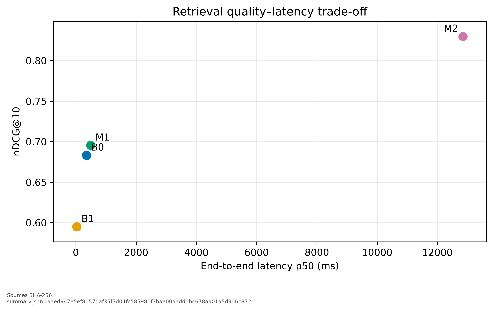
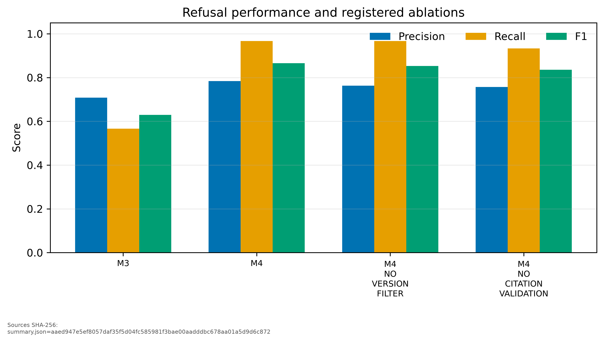
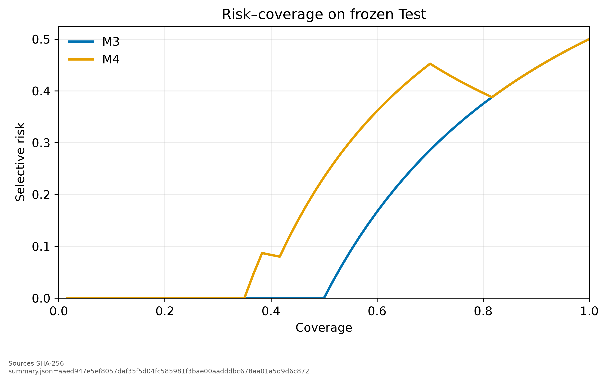

# S12 冻结 Test 最终结果

## 1. 结论边界

本报告只描述 `s4-golden-v1` 冻结 Test 的一次性执行结果。九条路线在查看 Test 结果前已经固定，运行时 `max_retries=0`；成功行和失败行均不可补跑。Test 结果查看后没有修改数据集、检索参数、重排深度、拒答阈值、Prompt 或引用合同。

这是一份当前数据集上的未见 Test 估计，不证明跨领域普适性、线上延迟可接受性或任意技术文档上的稳定优势。人工复核覆盖固定抽取的 9 个代表样本，不等于对 60 题全部回答做人工质量评分。Test 没有运行 Judge，因此没有 Judge—人工一致率或 Cohen's kappa。

## 2. 数据与一次性执行

- 数据集：`data/eval/s4-golden-v1/test.jsonl`
- 固定题数：60（30 可回答、30 边界题）
- 数据 SHA-256：`67bbafdb8841a15f58de0cd66cf14f488f142a2f1e44bff360ef17647e56adeb`
- 执行账本：[`reports/s12_final/execution-ledger.json`](../reports/s12_final/execution-ledger.json)
- 预检密封：[`reports/s12_final/preflight.json`](../reports/s12_final/preflight.json)
- 方法顺序：B0 → B1 → M1 → M2 → B2 → M3 → M4 → M4 去版本过滤 → M4 去引用验证
- 总逐题记录：540；九个 run 均为 `completed`

原始结果是唯一事实源；[`reports/s12_final/summary.json`](../reports/s12_final/summary.json) 和 [`reports/s12_final/tables/`](../reports/s12_final/tables/) 均由原始逐题记录离线派生。

## 3. 检索与重排

| 方法 | Recall@10 | MRR@10 | nDCG@10 | 端到端 p50 | 原始结果与 SHA-256 |
| --- | ---: | ---: | ---: | ---: | --- |
| B0 BM25 | 0.7667 | 0.7400 | 0.6831 | 356.82 ms | `raw/b0/results.jsonl` — `f53732b5ee32d9b671a5375bf4c3e91e073de8e7ec2aed300195b4ef78d1489c` |
| B1 Dense | 0.8000 | 0.6472 | 0.5951 | 29.29 ms | `raw/b1/results.jsonl` — `ef7125c5f61f772768ffe769c196c63c959d26ca014dd62fa7281940c09aaec0` |
| M1 1wRRF | 0.8667 | 0.6964 | 0.6955 | 491.04 ms | `raw/m1/results.jsonl` — `6fcc282acbaf7a2e9497a1abd73f08b6b4b2e4fcd0e734a34293131fb72a82c1` |
| M2 + Cross-Encoder | 0.9000 | 0.8278 | 0.8298 | 12,848.34 ms | `raw/m2/results.jsonl` — `a1e3ffaf8aba6b51c01b8cc48f8dbd4df2f46f44c7178f5ff197c6709f15788d` |

10,000 次逐题配对 bootstrap（seed `20261014`）给出：

- M1 相对 B1：nDCG@10 `+0.1004`，95% CI `[0.0184, 0.1892]`；MRR@10 CI 跨 0，不能写成所有指标全面胜出。
- M1 相对 B0：Recall@10 `+0.1000`，CI `[0, 0.2333]`；MRR/nDCG 的 CI 均跨 0。
- M2 相对 M1：MRR@10 `+0.1313`，CI `[0.0008, 0.2611]`；nDCG@10 `+0.1344`，CI `[0.0385, 0.2354]`。

M2 在当前 Test 上提高了排序质量，但端到端 p50 从 M1 的 0.49 秒上升到 12.85 秒。它是离线质量路线，不应直接作为低延迟生产默认值。

## 4. 生成、拒答与消融

| 方法 | 成功/失败 | Citation P/R | 拒答 P/R/F1 | False accept/reject | API 成本 | 原始结果 SHA-256 |
| --- | ---: | ---: | ---: | ---: | ---: | --- |
| B2 Dense + 生成 | 44/16 | 0.7160 / 0.6360 | — | — | $0.070666 | `34d9c74079c893493fcb63283d12b0935a8a3f89a52e7dcf77e3107544b915b1` |
| M3 去拒答 | 51/9 | 0.7394 / 0.8015 | 0.7083 / 0.5667 / 0.6296 | 13 / 8 | $0.042219 | `14b12703296bffebf1beb3a6e3394acb6d7120154b6798ddf80900d1f892af34` |
| M4 完整方法 | 58/2 | 0.7398 / 0.8941 | 0.7838 / 0.9667 / 0.8657 | 1 / 9 | $0.008621 | `59c078378db112d192bbe4b2b81455a347f7e3661c8b4cecea7a5677baadacd0` |
| M4 去版本过滤 | 58/2 | 0.7738 / 0.7616 | 0.7632 / 0.9667 / 0.8529 | 1 / 9 | $0.025573 | `4517811b1881d73fa6032b35a4d9dabc11134a0c98f476bf18770dc59883d53b` |
| M4 去引用验证 | 58/2 | 0.7211 / 0.8888 | 0.7568 / 0.9333 / 0.8358 | 2 / 10 | $0.008065 | `d1993826443619dbca56ff258ca5de124d5f64c840db0557d70948776ca6e2be` |

完整 M4 相比 M3 将固定 60 题上的失败数从 9 降到 2，并把拒答 F1 从 0.6296 提高到 0.8657。M4 相对去版本过滤在共同 20 个可评分答案上的 Citation Recall 差为 `+0.1045`，95% CI `[0.0091, 0.2375]`；Citation Precision CI 跨 0。M4 与去引用验证的成功交集上 Citation Recall 差为 0、Precision CI 跨 0；引用验证的价值还包括失败关闭和阻止未知/空引用，不能只由成功交集均值判断。

五条在线路线 API 总成本为 `$0.155144`。这是根据保存的 token usage 和冻结单价计算的实验估算，不等同于平台账单实扣。

## 5. 人工复核

人工复核包位于 [`reports/s12_final/human_review_packet.json`](../reports/s12_final/human_review_packet.json)，SHA-256 为 `6b8b0f6bf3d399078f725f23bf16bbd236deebf059fe51572d759f24e2a97c9f`。项目所有者完成 9 题逐证据复核：

- 可评分 3 题，不可评分 6 题。
- 三道可评分题 Faithfulness 均值 `2.0/2.0`，Answer Relevance 均值 `2.0/2.0`。
- 多标签失败原因题数：`retrieval_miss=4`、`upstream_failure=1`、`generation_contract_failure=1`。当前样本没有使用 `dataset_question_ambiguity`。

三项实质发现必须与自动指标同时保留：

1. `s4-test-057` 被动作协议计为 false accept，因为 `action=answer` 而真值要求 `clarify`；人工审读发现文本实质上明确拒绝选择版本并请求用户补充版本，且附带陈述都有引用。这说明离散动作标签会低估某些自然语言澄清行为。
2. `s4-test-012/014` 因重排证据未达阈值被拒答；`s4-test-024/025` 因检索未同时提供两个版本证据而触发版本澄清。四题黄金章节均存在，人工主因统一为 `retrieval_miss`，不是题面歧义。
3. `s4-test-034` 是 OOD 问题。模型干净拒答但没有引用，统一“verified answer 至少一条引用”合同将其判为 `CitationValidationFailure`。机械归因正确，但后续版本应区分可回答答案与无证据拒答的引用要求。

人工发现只用于误差分析和下一版本设计，没有回调本次 Test 方法。

## 6. 可复现性与局限

- 原始结果、失败、usage、成本、模型身份、请求 ID 与逐阶段延迟全部保留。
- 每个正式目录只有一个固定 run ID；重新实验必须使用新目录，不能覆盖当前失败行。
- 图像同时提供 450 DPI PNG 和 SVG；图内写入来源 SHA-256，输出哈希见 [`figures/manifest.json`](../reports/s12_final/figures/manifest.json)。
- Test 只有 60 题，人工质量复核只有 9 题；置信区间和人工均值必须连同分母报告。
- 当前 Cross-Encoder 为 CPU ONNX 实现，延迟未经过量化、缓存或批处理服务优化。
- `deepseek-flash` 是滚动服务别名；仓库保存服务端 identity 和原始响应摘要，但不能保证未来服务端实现完全不变。
- PostgreSQL 17.11/18.6 是版本化技术文档代表场景，不足以证明对其他领域文档的泛化。
